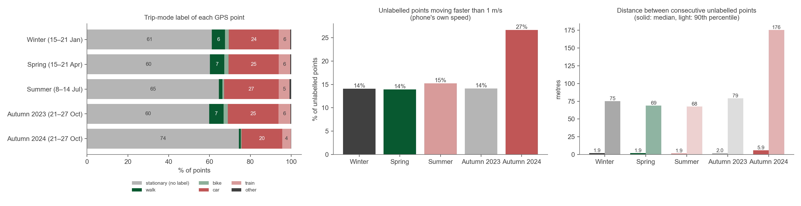
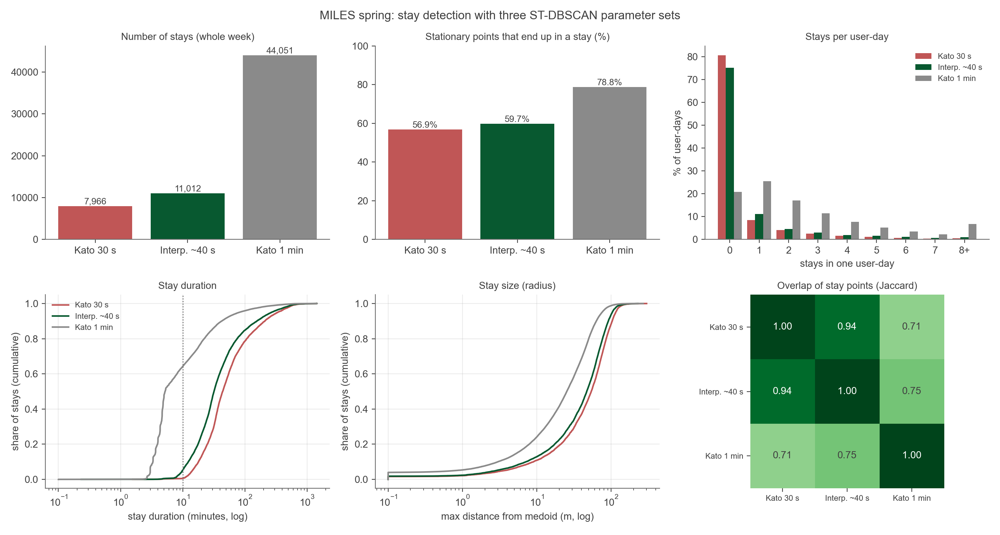
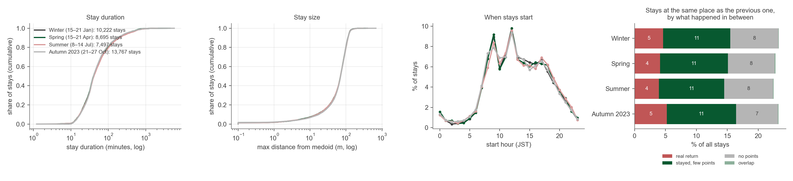
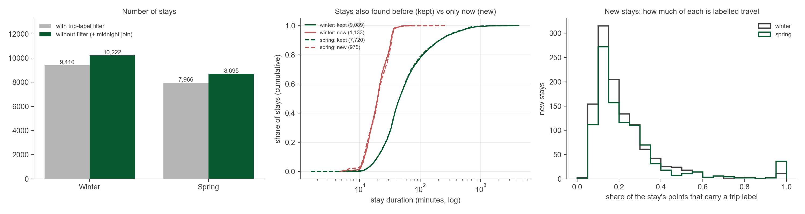
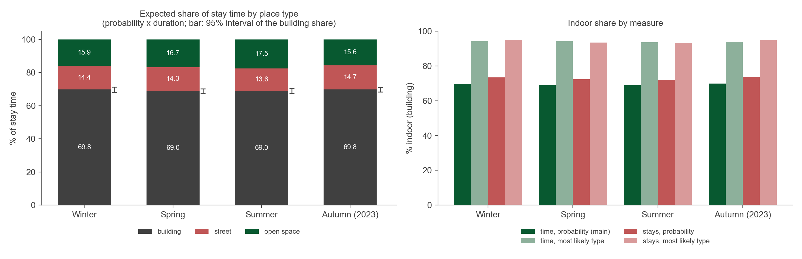
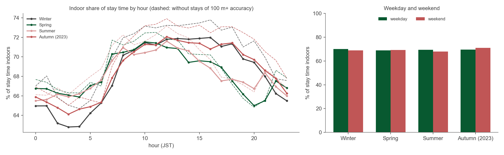
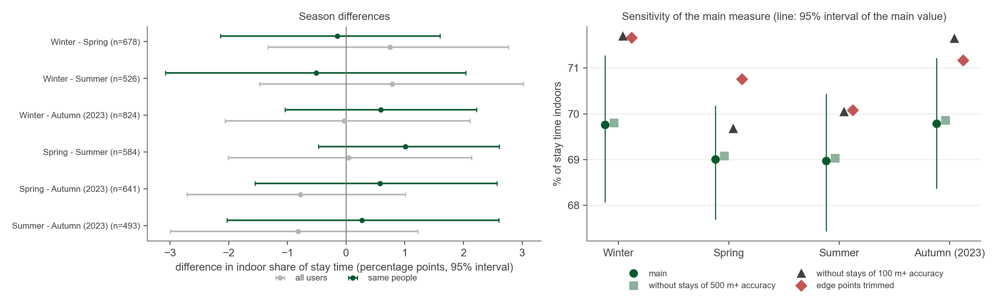
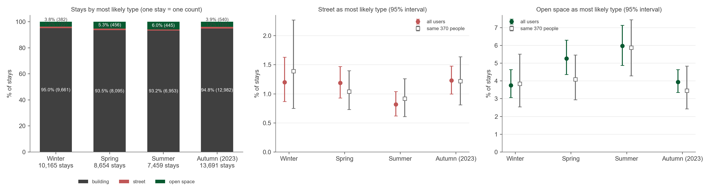

# Seasonal variance

Plan On-going Doctoral 26-10-2026

New work from the meeting on 20-10-2026 ([Publications and doctoral plan](../progress/d-progress-20-10-2026.md)).

**Goal:** see how the split between indoor and outdoor activity changes with the season in Hiroshima.

Take the framework as it is for now, as if it were final ([Final model](../analysis/m-final-model.md)), and apply it to MILES on one week per season:

| Season | Week |
|---|---|
| Spring | 15–21 April 2024 |
| Summer | 8–14 July 2024 |
| Autumn | 21–27 October 2024 |
| Winter | 15–21 January 2024 |

A small area is enough.

## In short

- The data of four seasons is ready: winter, spring, summer, and autumn. Autumn uses the 2023 week for now, because the 2024 week was collected in a different way.
- The stays (places where people stopped) look the same in every season: same length, same size, same start times.
- **Time:** people spend about 70% of their stay time inside buildings in every season. There is no difference between seasons.
- **Number of stays:** when each stay counts once, spring and summer have more stays in open space (parks, plazas) than winter and autumn: about 5–6% against about 4%.
- Some problems in the data are still open. They are listed at the end, with questions for sensei.

## What was done

Four steps, the same for every season:

1. **Clip.** Keep only the GPS points inside the study area. The area is the same as for the ground truth (GT): central Hiroshima, about 12 km × 9.5 km. All maps and points use one map projection (EPSG:32653), so distances are in metres. The points are not thinned out as they were for the GT ([Downsampling to MILES density](../concepts/m-downsampling-to-miles-density.md)).
2. **Overview.** Check how often the phones record a point and how far apart the points are. This is needed to choose the settings of the next step.
3. **Stay detection.** Find the stays. A stay is a group of GPS points that are close together in space and in time. The method is called ST-DBSCAN. It has three settings:
    - **eps1:** the largest distance between points of one stay;
    - **eps2:** the largest time gap between points of one stay;
    - **min_samples:** the smallest number of points that makes a stay.

   The settings come from Kato et al. (2024), who tested them on GPS data from Hiroshima.
4. **Framework.** For each stay, the model gives three probabilities: building, street, and open space. Then indoor and outdoor are compared across the seasons.

| Season                  | Clip | Overview | Stay detection      | Framework |
| ----------------------- | ---- | -------- | ------------------- | --------- |
| Winter (15–21 Jan 2024) | done | done     | done                | done      |
| Spring (15–21 Apr 2024) | done | done     | done                | done      |
| Summer (8–14 Jul 2024)  | done | done     | done                | done      |
| Autumn (21–27 Oct 2023) | done | done     | done                | done      |
| Autumn (21–27 Oct 2024) | done | done     | on hold (problem 4) |           |

**Why autumn 2023?** The autumn 2024 week looks different from the other weeks. Autumn 2023 was added to check whether the cause is the season or the way the data was collected. Autumn 2023 looks like the other weeks, so the cause is the data collection. **For now, autumn 2023 stands for autumn** (decision of 10-11-2026).

**Decisions for stay detection** (10-11-2026):

- **Every GPS point is used.** MILES gives some points a trip label (walk, car, train, ...). Before, these points were removed before stay detection. Now they are kept, because the labels are not reliable in every week (problem 4).
- **Stays cut at midnight are joined again**, but only when it is certain that they are one stay (problem 2).
- **One visit that is cut into two stays is not joined** for now (problem 3).

## The data

|                                        |    Winter |    Spring |    Summer | Autumn 2024 | Autumn 2023 |
| -------------------------------------- | --------: | --------: | --------: | ----------: | ----------: |
| GPS points in the area                 | 2,821,778 | 2,349,164 | 2,088,422 |   1,406,182 |   3,696,829 |
| People                                 |     6,006 |     5,146 |     4,536 |       3,090 |       8,693 |
| Time between two points (median)       |      41 s |      41 s |      41 s |        40 s |        41 s |
| Points with accuracy of 100 m or worse |     14.7% |     15.3% |     17.6% |       14.3% |       15.5% |

- The phones record **about one point every 40 seconds**, in every week and at every hour of the day.
- **The number of people changes a lot** from week to week. Autumn 2024 has only about a third of the people of autumn 2023.

**Checks on the raw points** (before building stays):

- Every week has the right year: four weeks of 2024 and one of 2023. Every time stamp falls inside its hour folder.
- No person has two points at the same time. No person sends points unusually fast.
- **The same people can be followed across seasons.** The person IDs are coded the same way in every week. For example, 2,984 people are in both winter and spring, and 1,612 in both autumns.
- Gender and age group are missing for about three in four people.

The left chart shows the trip label of each point. A point without a label counts as not travelling. Winter, spring, and autumn 2023 look the same. Summer and autumn 2024 have far fewer walk labels (problem 4).

## Choosing the stay settings

Kato et al. (2024) give settings for phones that record every 30 seconds and every 1 minute. MILES records about every 40 seconds, which is in between. So three options were tested on spring:

|                                    |        Kato 30 s | In between (~40 s) |     Kato 1 min |
| ---------------------------------- | ---------------: | -----------------: | -------------: |
| Settings (eps1, eps2, min_samples) | 70 m, 1100 s, 18 |    63 m, 920 s, 14 | 50 m, 610 s, 6 |
| Stays found (one week)             |            7,966 |             11,012 |         44,051 |
| Typical stay length (median)       |           44 min |             32 min |          5 min |
| Stays shorter than 10 minutes      |             0.6% |               5.3% |            64% |

- **30 s and in between** find almost the same stays: 94% of the stay points are the same. The in-between settings only add about 3,000 short stays of 10–18 minutes.
- **1 min** finds four times as many stays. Most are stops of about 5 minutes, and long visits break into many small pieces. These settings do not fit MILES.
- **Chosen: the 30 s settings** (70 m, 1100 s, 18). With one point every 41 seconds, this means a stay lasts at least about 12 minutes.

## Stays in the four seasons

|                                         | Winter | Spring | Summer | Autumn (2023) |
| --------------------------------------- | -----: | -----: | -----: | ------------: |
| Stays                                   | 10,222 |  8,695 |  7,497 |        13,767 |
| People with at least one stay           |  1,649 |  1,369 |  1,180 |         2,050 |
| Share of people with at least one stay  |    27% |    27% |    26% |           24% |
| Stays per person (people with a stay)   |    6.2 |    6.4 |    6.4 |           6.7 |
| Typical stay length (median)            | 40 min | 41 min | 42 min |        41 min |
| Stays joined over midnight              |    260 |    185 |    201 |           349 |
| Spread of the points in a stay (median) | 19.7 m | 19.8 m | 19.8 m |        20.1 m |

The spread of the points is σ (sigma), see [sigma](../concepts/m-sigma.md).

**The stays look the same in every season**: same length, same size, same start times. So if the seasons differ, the difference must be in **where** people stay (indoor or outdoor). That is the next step. The start-hour chart no longer has a peak at midnight, because stays cut at midnight are now joined.

**What changed when all points were kept** (winter and spring; all other settings the same):

|                                                 | Winter         | Spring        |
| ----------------------------------------------- | -------------- | ------------- |
| Stays: before → now                             | 9,410 → 10,222 | 7,966 → 8,695 |
| Earlier stays lost                              | 0              | 0             |
| New stays                                       | 1,133          | 975           |
| New stays made mostly of travel points          | 48             | 74            |
| Stay points that are the same as before         | 96%            | 96%           |

- **No stay was lost.** About 1,000 new stays appear per season.
- The new stays are shorter: 20 minutes (median), against 45. Only about 5–7% of them are mostly travel points.
- Many stays now have a few travel points at their edges: the arrival and the departure (problem 9).

## Indoor or outdoor?

The model ([Final model](../analysis/m-final-model.md)) was used exactly as it was trained on the GT. It was not trained again on MILES. For each stay it gives three probabilities that add up to 1: building, street, and open space.

- **Indoor** = building.
- **Outdoor** = street or open space.

There are **two ways to count**. An example: a stay of 2 hours with P(building) = 0.7, P(street) = 0.1, P(open space) = 0.2.

- **Way 1, time with probabilities** (the main measure, decision of 10-11-2026). The stay adds 1.4 hours indoors (2 × 0.7) and 0.6 hours outdoors. Long stays count more than short ones, and the uncertainty of the model is kept.
- **Way 2, one stay = one count.** The stay gets the type with the highest probability (here building) and counts as one building stay. Every stay counts the same, short or long.

A **95% interval** shows how sure a number is. It comes from a bootstrap: the people of a season are drawn again at random 1,000 times, and the number is computed again each time. When the interval of a difference between two seasons includes zero, the difference is not significant (it may be chance).

### Way 1: share of time indoors

|                               |       Winter |       Spring |       Summer | Autumn (2023) |
| ----------------------------- | -----------: | -----------: | -----------: | ------------: |
| Stays                         |       10,165 |        8,654 |        7,459 |        13,691 |
| People                        |        1,647 |        1,367 |        1,178 |         2,047 |
| **Indoor share of stay time** |    **69.8%** |    **69.0%** |    **69.0%** |     **69.8%** |
| 95% interval                  |   68.1–71.3% |   67.7–70.2% |   67.4–70.4% |    68.4–71.2% |
| Street / open space           | 14.4 / 15.9% | 14.3 / 16.7% | 13.6 / 17.5% |  14.7 / 15.6% |

(Stays with no building, street or open space within 10 m are not counted: 38–76 per season.)

- **No season is different.** All differences are smaller than 1 percentage point, and none is significant.
- **The same people show the same.** 370 people have stays in all four seasons. Their indoor share is 68–70% in every season, with no significant difference. The same holds for people who appear in two seasons (493–824 people per pair).

- **By hour:** about 71–72% indoors around midday, but only 63–67% at night (00:00–06:00). This is probably **not** real time outdoors. Most night stays are long stays at home, and their positions are often rough:

| Typical accuracy of the stay | Average P(building) |
| ---------------------------- | ------------------: |
| 10–50 m                      |           0.74–0.76 |
| exactly 100 m                |                0.68 |
| 500 m or worse               |                0.58 |

  A rough position can fall on the street or the open space next to the home. Stays of 8 hours or more get P(building) = 0.63 on average.
- **Weekday and weekend** are almost the same in every season.

**Checks** (sensitivity: does the result change when the data is cleaned in another way?). Indoor share of stay time:

|                                                         | Winter | Spring | Summer | Autumn (2023) |
| ------------------------------------------------------- | -----: | -----: | -----: | ------------: |
| Main result                                             |  69.8% |  69.0% |  69.0% |         69.8% |
| Without stays with typical accuracy of 500 m or worse   |  69.8% |  69.1% |  69.0% |         69.9% |
| Without stays with typical accuracy of 100 m or worse   |  71.7% |  69.7% |  70.1% |         71.7% |
| Travel points at the edges of stays removed (problem 9) |  71.7% |  70.8% |  70.1% |         71.2% |

The cleaning raises the indoor share by about 1–2 points in every season. The seasons stay as close as before. Without the 100 m stays, the dip at night becomes smaller but does not disappear.

### Way 2: one stay = one count

|                          | Winter         | Spring         | Summer         | Autumn (2023)  |
| ------------------------ | -------------: | -------------: | -------------: | -------------: |
| Stays                    |         10,165 |          8,654 |          7,459 |         13,691 |
| Building                 |  95.0% (9,661) |  93.5% (8,095) |  93.2% (6,953) | 94.8% (12,982) |
| Street                   |     1.2% (122) |     1.2% (103) |      0.8% (61) |     1.2% (169) |
| **Open space**           | **3.8%** (382) | **5.3%** (456) | **6.0%** (445) | **3.9%** (540) |
| Open space, 95% interval |       3.1–4.6% |       4.4–6.3% |       4.9–7.1% |       3.4–4.6% |

- **Here the seasons differ.** Spring and summer have more stays in open space (5.3% and 6.0%) than winter and autumn (3.8% and 3.9%). These differences are significant.
- **The same 370 people:** summer has more open-space stays than each of the other three seasons (5.9% against 3.5–4.1%). For these people, spring is not higher than winter or autumn.
- **Street** stays are very few in every season (about 1%).

### Why the two ways disagree

- **Building wins most of the time, but rarely with full certainty.** Building has the highest probability for 93–95% of stays. Yet the probabilities put only 69–70% of the time indoors. Way 1 keeps this uncertainty; Way 2 rounds it away.
- **Way 1 is dominated by long stays** at home and at work, which do not change with the season. A small change in short visits to parks is lost in them.
- **Open-space stays are not shorter.** They last about 40 minutes, like the other stays. So the difference does not come from their length.
- **Be careful with Way 2.** Outdoor stays are few (street 61–169 and open space 382–540 per season). And a stay counted as open space is not certain: its P(open space) is 0.71 on average.

### Limits of these first results

- The model learned from GT stops of about 10 minutes in the daytime. MILES stays are longer and include whole nights at home, which the GT never had.
- Autumn is the 2023 week.
- Visits cut into two stays are not joined (problem 3).
- The travel points at the edges of stays make the stays wider (problem 9).

## Problems found in the data

1. **Times are in UTC, not Japan time.** UTC is 9 hours behind Japan. So each downloaded week runs from 09:00 on the first day to 08:59 on the day after the last day (Japan time). The first and the last day are incomplete and are marked as partial. About 100 stays per season are cut where the week starts or ends.

2. **Stays are cut at midnight** (fixed). Stays are searched day by day, so a stay over midnight became two stays. Before the fix, about 3% of stays started just after midnight or ended just before it. Now the two parts are joined only when all of these are true:
    - the first part ends at most 5 minutes before midnight;
    - the second part starts at most 5 minutes after midnight;
    - their centre points are at most 70 m apart;
    - the person never goes more than 70 m away in between.

   Almost every pair passes (winter 260 of 264, spring 185 of 187, summer 201 of 201, autumn 349 of 351). About 30–70 stays per season still start or end near midnight; they did not pass the checks.

3. **One visit is cut into two stays** (not fixed yet). About 23% of stays start at the same place as the person's previous stay that day. What happened between the two stays?
    - **The person stayed, but the phone recorded little** (11% of all stays). The person did not go more than 200 m away, but the phone recorded only about 2 points per 15 minutes instead of about 22. A stay needs 18 points close in time, so this time is not counted as a stay. Phones record less often when they do not move.
    - **No points at all** (7–8% of all stays). The phone recorded nothing, usually for 15–17 minutes.
    - **The person really left and came back** (4–5% of all stays). The person went more than 200 m away and came back, usually after about 2 hours.

   So about 4 in 5 of these pairs are **one visit cut in two**. Joining them would reduce the stays by about 18–19% (winter 10,222 → 8,309, spring 8,695 → 7,072, summer 7,497 → 6,107, autumn 13,767 → 11,277). The missing time between the parts is mostly time spent still, probably indoors. So **indoor time is probably counted too low** now.

4. **Fewer walk labels in summer and autumn 2024.**
	- **It is not the season.** Autumn 2023 looks exactly like winter and spring. So autumn 2024 is different because of how the data was collected or processed, as sensei suggested. The autumn 2024 files also have another format: other column names, extra ID columns, another folder structure, and a missing speed written as −2.24 instead of left empty. The speed is still in metres per second.
	- **Autumn 2024:** many people who walk are counted as not travelling. 27% of the unlabelled points move at walking pace or faster, against 14% in the other weeks. These walking points would end up in stays, so autumn 2024 stays cannot be compared with the other weeks.
	- **Summer:** the files have the usual format, and the unlabelled points move as in winter and spring. The walk labels drop on every day of the week (1.2–2.1%), but the share of points moving at walking speed stays the same (about 8%). So **the labelling changed, not the walking.** Summer and autumn 2024 are both after April 2024, so the labelling may have changed between April and July 2024. The effect on the summer stays looks small.

|                                       | Winter | Spring | Summer | Autumn 2024 | Autumn 2023 |
| ------------------------------------- | ------ | ------ | ------ | ----------- | ----------- |
| Points labelled walk                  | 6.5%   | 7.1%   | 1.7%   | 0.9%        | 7.0%        |
| Labelled trips that are walking trips | 29%    | 30%    | 10%    | 9%          | 30%         |
| Unlabelled points faster than 1 m/s   | 14%    | 14%    | 15%    | 27%         | 14%         |

5. **Many points say "exactly 100 m" accuracy.** 12% of all points, and 20% of points that are not travelling, report an accuracy of exactly 100 m. 97% of them come from Android phones. This looks like a fixed value for a rough position, not a real measurement. These points are much more common in long stays (28% of the points) than in short stops (5%).

6. **Most people only pass through.** Three in four person-days have no stay in the area. A person-day has about 67 points (median), roughly 45 minutes of recording inside the area.

7. **Some positions are very rough.** About 0.6% of points report an accuracy of 1,000 m or worse. Some of them sit at exactly the same spot for many people (up to 35 people at one spot, with an accuracy of 1,500 m in winter and 2,200 m in autumn). This is probably a position from the phone network, not from GPS. About 1–2% of stays have a typical accuracy of 500 m or worse (winter 152, spring 143, summer 84, autumn 240).

8. **Small things.**
    - 26–67 stays per season have fewer than 18 points. This is a known side effect of the method, which can share border points between nearby stays. They are kept.
    - Two map layers (street centre lines and open space) used another map projection (EPSG:6691). They now use EPSG:32653. The shapes did not change, so no earlier result changes.

9. **Stays are wider now that all points are kept.** Travel points now join a stay when they are close enough in space and time: mostly the arrival and the departure, at the edges of the stay.
    - They are only 2.4% of the stay points, but they lie far from the centre: 43 m (median), against 2 m for the other points.
    - 61% of stays have at least one.
    - The spread of a stay (σ) grows from 15.3 m to 19.8 m in spring, and the largest distance from the centre from 54 m to 71 m.
    - σ is one of the inputs of the model ([sigma](../concepts/m-sigma.md)), so this changes the results a little (see the checks above).

## Questions for sensei

1. **Join visits cut in two?** The rule would be: join two stays at the same place when the person did not go more than 200 m away in between (problem 3). This is a new rule, added on top of the method of Kato et al.
2. **Walk labels.** Ask the data provider: did the trip labelling change between April and July 2024? Can autumn 2024 be processed like the other weeks (problem 4)? Autumn 2023 is used until then.
3. **Travel points at the edges of stays.** Keep them, or remove them after stay detection so that σ does not grow (problem 9)?
4. **The 100 m points.** Keep them as now, or treat them separately (problem 5)? Leaving out the stays they dominate raises the indoor share by up to 2 points.
5. **Night stays.** The model learned from daytime stops. Should long night stays at home be checked separately, for example with a few nights where the answer is known? They get a lower P(building).

Part of [Doctoral plan](../threads/d-doctoral-plan.md).

**Linked from** [Doctoral plan](../threads/d-doctoral-plan.md) · [Publications and doctoral plan](../progress/d-progress-20-10-2026.md)

