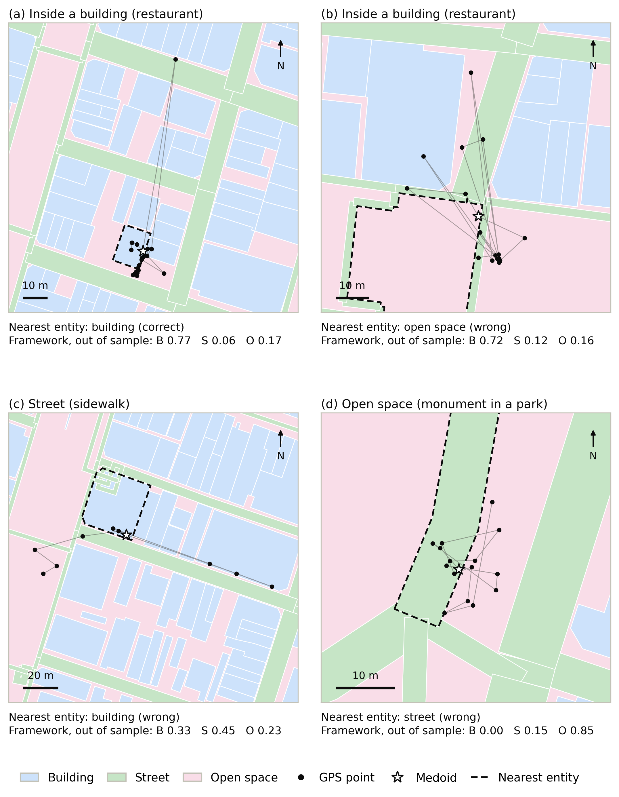
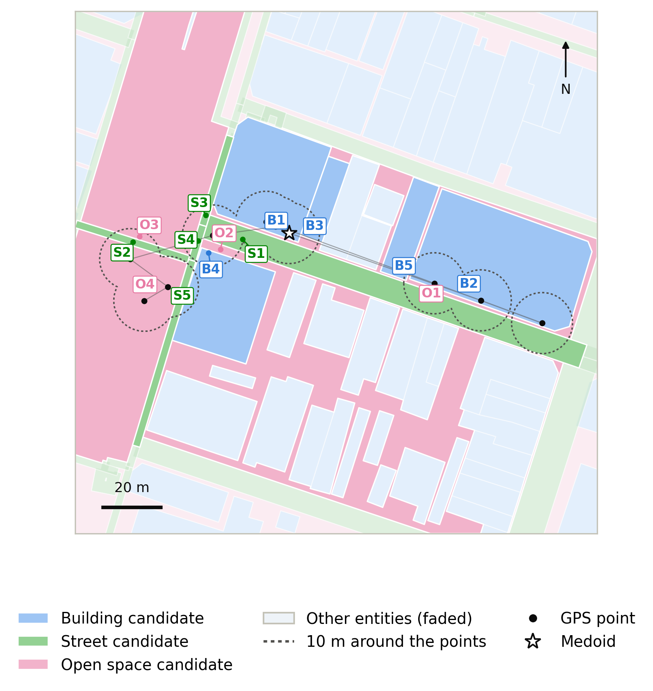

# CEUS paper revisions

Progress Doctoral 05-11-2026

The update for the meeting with sensei on 05-11-2026. The meeting on 20-10-2026 asked for three changes to the CEUS paper ([CEUS paper](../plans/m-ceus-paper.md), [Publications and doctoral plan](d-progress-20-10-2026.md)). All three are now in the draft, with a light comparison with nearest-entity assignment, as sensei suggested. Everything comes from the official data and the [Final model](../analysis/m-final-model.md). No model was fitted again.

## 1. One column

- The paper now uses Elsevier's one-column layout for submission (`preprint`, 12 pt). It has 27 pages.
- The tables, the equations and the figure sizes were adjusted to the new width.
- Every figure and table stays inside its own section, before the Conclusion and the references.

## 2. Indoor and outdoor stays on a map

Four stays from the ground truth: two inside buildings, one on a street and one in an open space. The map is at the start of Section 4.2 (validation).

- **Black dots** are the GPS points of the stay, joined in time order. The **star** is the medoid: the GPS point closest to the centre of the stay.
- **Nearest-entity rule.** The usual deterministic method: the stay goes to the place nearest the medoid (or the place that contains it). The **dashed outline** shows that place.
- **Below each map**: what the nearest-entity rule says, and the probability the framework gives each type (B building, S street, O open space). The probabilities are out of sample: the model that gives them was fitted without that stay ([Grouped cross-validation](../concepts/m-grouped-cross-validation.md)).
- **What the maps show.** Indoors (a, b), the points do not stay inside one building: they spread into the streets and open space around it (σ about 19 m). In (b) the medoid falls in open space. On the street (c), the medoid falls inside the building next to the sidewalk. In the park (d), most points are in open space, but the medoid falls on a park path that the map counts as a street segment ([Street segmentation](../plans/d-street-segmentation.md)).
- In all four, the framework gives the correct type the highest probability. The four stays were chosen among stays the framework gets right, so they show how the method works, not how often it works.

**Over all 907 stays:**

| | Accuracy | Building | Street | Open space |
|---|---:|---:|---:|---:|
| Nearest-entity rule | 0.479 | 0.501 | 0.281 | 0.607 |
| Framework (out of sample) | 0.719 | 0.900 | 0.486 | 0.440 |

- The framework is correct on 305 stays where the rule is wrong. The rule is correct on 87 stays where the framework is wrong.
- In 9 stays the medoid lies inside a building and a street at the same time (the two map layers overlap). The rule then picks building.

## 3. One stay through every step

The street stay of map (c) goes through the method in Sections 3.1 to 3.3 ([Framework overview](../concepts/m-framework-overview.md)). A participant stood on the sidewalk of Fukutomachi Road for 10 minutes. After downsampling, the stay has 10 GPS points, and they are very spread out (σ = 46.5 m).

**Step 1: candidates** ([Candidate selection](../concepts/m-candidate-selection.md)). Every place within 10 m of at least one GPS point: 5 buildings (B1 to B5), 5 street segments (S1 to S5) and 4 open spaces (O1 to O4). Only 1 of the 10 points falls inside a street. Three fall inside building B1, three inside a building further east, and three in open space about 50 m to the west.

**Step 2: scores** (the same table is in the paper, Section 3.2).

| Candidate | Distance to medoid (m) | f_distribution | f_distance | f_temporal | f_directional |
|---|---:|---:|---:|---:|---:|
| B1 | 0.0 | 0.55 | 1.00 | 0.93 | 0.07 |
| B2 | 42.3 | 0.38 | 0.95 | 0.38 | 0.08 |
| B3 | 3.8 | 0.27 | 1.00 | 0.27 | 0.08 |
| B4 | 13.5 | 0.24 | 0.99 | 0.29 | 0.07 |
| B5 | 32.4 | 0.16 | 0.97 | 0.16 | 0.08 |
| S1 | 2.8 | **0.93** | 1.00 | 0.93 | **0.92** |
| S2 | 32.3 | 0.29 | 0.97 | 0.29 | **0.93** |
| S3 | 26.5 | 0.23 | 0.98 | 0.23 | 0.27 |
| S4 | 27.2 | 0.23 | 0.98 | 0.23 | 0.27 |
| S5 | 31.9 | 0.03 | 0.97 | 0.03 | 0.27 |
| O1 | 1.8 | **0.93** | 1.00 | 0.93 | 0.07 |
| O2 | 10.8 | 0.37 | 1.00 | 0.29 | 0.07 |
| O3 | 28.4 | 0.27 | 0.98 | 0.27 | 0.07 |
| O4 | 34.7 | 0.07 | 0.96 | 0.07 | 0.07 |

How to read it:

- [f_distribution](../concepts/m-f-distribution.md): S1 (the sidewalk) and the open space O1 next to it are near the points for 93% of the time. Building B1, which contains the medoid, gets 55%.
- [f_distance](../concepts/m-f-distance.md): above 0.94 for every candidate. The points are so spread out that distance does not separate the candidates for this stay.
- [f_temporal](../concepts/m-f-temporal.md): close to f_distribution for most candidates. This overlap is why the final model drops it.
- [f_directional](../concepts/m-f-directional.md): the steps between points follow the road. S1 and S2 (the two segments of Fukutomachi Road) score 0.92 to 0.93, the cross streets 0.27, every building and open space below 0.08.

**Step 3: utility** (a second table, Section 3.3). The final weights turn the scores into a value $V_k$ for each candidate. Two more inputs enter. [share_type](../concepts/m-share-type.md): 5 of the 14 candidates are streets, so every street loses 5.163 × 5/14 = 1.84. [sigma](../concepts/m-sigma.md): the points are spread out, so every street and open-space candidate gains 1.016 × 1.332 = 1.35. S1 has the highest value, 2.09.

**Step 4: probability.**

| | Building | Street | Open space |
|---|---:|---:|---:|
| Final model (fitted on all 907 stays) | 0.31 | **0.50** | 0.20 |
| Out of sample (fitted without this stay) | 0.33 | **0.45** | 0.23 |
| Nearest-entity rule | B1 (wrong) | | |

The framework picks street, which is correct. It still gives almost a third to building, so the reader can see that this stay is uncertain.

## 4. Other changes in the paper

- **A table of the final weights** in Section 4.1, because the worked example uses them. The same sentence explains why the distance weights for street and open space are negative: at α = 2.764, f_distance is close to 1 for most candidates (median 0.95), so these weights act mostly as a fixed extra value for each type.
- **Definitions that were missing**: the medoid, share_t (the share of the stay's candidates that have the candidate's type) and the σ input.
- **share_t wording.** Section 4.2 now speaks of a share, not a count of competing segments, which matches [share_type](../concepts/m-share-type.md).

## Points for sensei

1. **Margins.** The submission layout has wide margins. Elsevier's `3p` layout in one column looks like the printed journal page and is shorter.
2. **Nearest-entity in the abstract?** The comparison (0.479 against 0.719) is now in Section 4.2 only. The abstract and the conclusion are unchanged.
