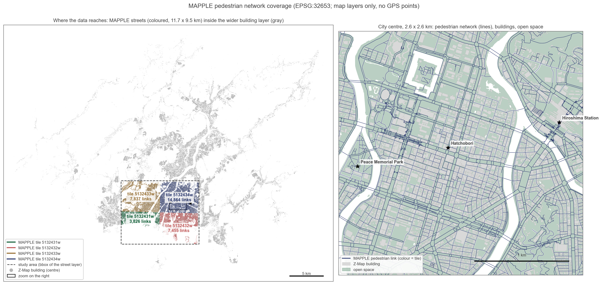
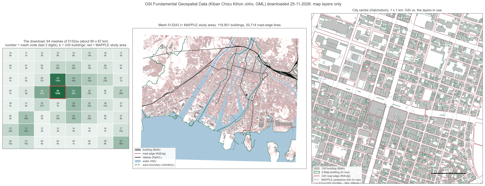
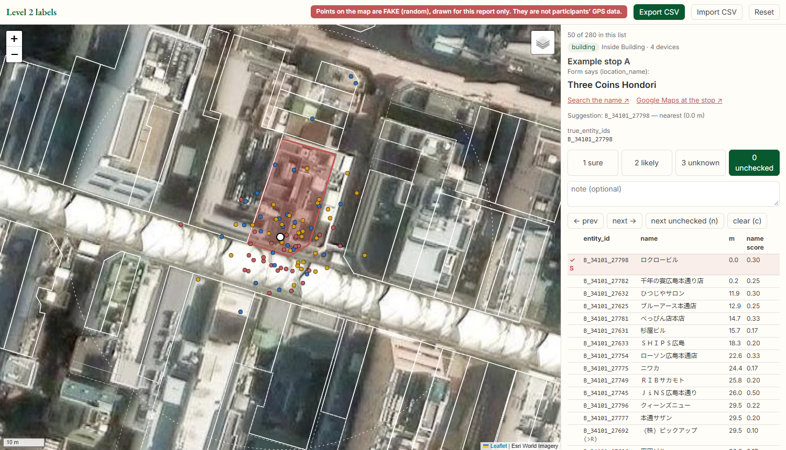
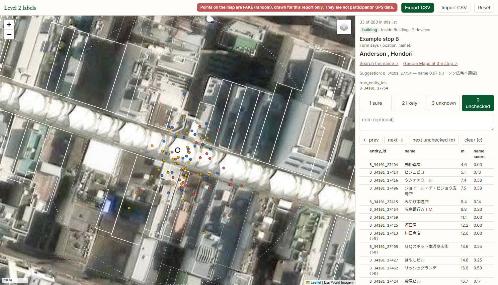
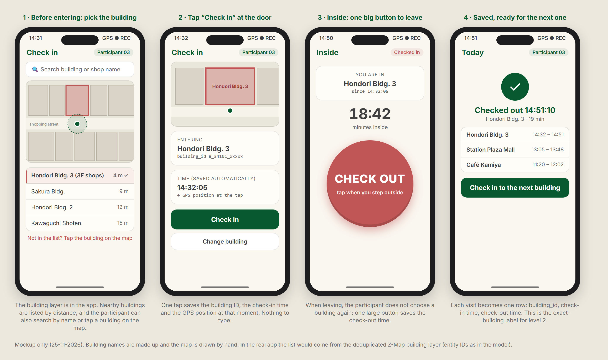

# Individual meeting progress

Progress Doctoral 25-11-2026

## 1. Paper direction
### Methodological Framework

- **Target journal:** Computer, Environment and Urban Systems (CEUS)
- **Main topic:** Develop and validate the probabilistic stay-cluster assignment framework using the Hiroshima ground-truth data. The main contribution is methodological: how to assign GPS stays probabilistically to buildings, streets, and open spaces under positional uncertainty.
- **Progress**: Completing the draft as a whole.
## Transferability

- **Target journal:** Transportation Research Part C: Emerging Technologies (TRC)
- **Main topic:** Collect additional ground-truth data in different urban environments, particularly dense urban areas such as central Tokyo, and examine whether the Hiroshima-calibrated model is transferable across urban contexts. Then apply the validated framework to the nationwide MILES dataset.
	- Applying framework to bigger data (whole year or seasonal variance)
- **Progress**: Rough idea

## 2. Implementation things

### Final ST-DBSCAN Hyperparameters

| Settings (eps1, eps2, min_samples) | Shortest stay | Stays per season | Typical stay length |
| ---------------------------------- | ------------- | ---------------: | ------------------: |
| Kato 30 s (70 m, 1100 s, 18)       | about 12 min  |     7,497–13,767 |              40 min |
| In between (63 m, 920 s, 14)       | about 9 min   |    10,714–19,603 |              29 min |
| Kato 1 min (50 m, 610 s, 6)        | about 4 min   |    45,742–81,332 |               5 min |

| Settings   | Winter | Spring | Summer | Autumn (2023) |
| ---------- | -----: | -----: | -----: | ------------: |
| Kato 30 s  |  74.9% |  70.7% |  70.4% |         74.9% |
| In between |  74.8% |  71.2% |  71.0% |         74.9% |
| Kato 1 min |  71.4% |  68.8% |  68.6% |         71.4% |
- All three settings show the **same direction.**
- **The 1 min settings find many very short stops** (two thirds under 10 minutes). These are more often outside: about 10% of the stays are open space, against 4–8% with the other settings, and the share of time in buildings is lower in every season. The seasonal difference becomes smaller.
- The model **learned from stops of about 10 minutes,** so the 1 min stays (typically 5 minutes) are shorter than anything the model has seen.
- Comparison for 3 x 365 days seems pretty computationally expensive.
- Might be better to decide one setting.
### Problem with Data
#### MILES data label
- Label that could be used?
	- trip_mode
	- device_os
	- heading
	- altitude
- gender 76% NA
- age_group 73% NA

#### Street network limitation

- Our smallest boundary of analysis is bounded by MAPPLE pedestrian network,
- Should we scale up for 365 days analysis?

#### Kiban Chizu Kihon Joho (基盤地図情報)
- Found some additional data from https://service.gsi.go.jp/kiban/app/

- **What it is:** the official base map of Japan from GSI. It is free and comes as GML files, one per map mesh.
- **Area:** the download has 64 meshes and covers about 80 × 67 km around Hiroshima. Our study area (the MAPPLE area, mesh 513243) is only one of these meshes (the red square, left).
- **Layers:** building footprints, road edges, sidewalk lines, railways, rivers and sea, ward boundaries, contour lines.
- **Buildings, compared with Z-Map** (inside our study area):
	- GSI has 119,951 buildings and Z-Map has 116,452. The shapes mostly match (right panel).
	- Sometimes GSI draws one block where Z-Map draws several buildings, or the other way round.
	- GSI has no building names, floors or uses. Z-Map has them.
- **Roads:** GSI only has the edges of the road surface. It is not a network with links and nodes like MAPPLE, so it cannot replace MAPPLE for the street candidates.
- **Possible uses:**
	- draw the road surface and the open spaces more exactly;
	- check the Z-Map buildings;
	- get buildings for a larger area if the analysis is scaled up.

## 3. Exact building probabilities stuck

- Matching one by one building to form is too hard and time consuming
- **The task:** for each of the 280 physical stops, find the one building (or street, or open space) that the self-report form names. The form gives a shop name, and the map gives building polygons with Z-Map building names.
- So far, every one of the 280 stops is still unchecked.
	- The tool makes a first guess automatically: the nearest entity for 217 stops, and a name match for 63.
	- The guess still has to be checked by hand, one stop at a time.
- **Hondori is the hardest place.** The buildings are narrow, the arcade roof hides the street, and shop names are not building names.
- **Example A, "Three Coins Hondori":**
	- There are 53 candidate buildings within 10 m.
	- "Three Coins" does not appear in any building name.
	- The nearest building (the red polygon) has a different name, and it is not clear which building the shop is in.

- **Example B, "Anderson, Hondori":**
	- The name match picks a Lawson (ローソン広島本通店), because the two names look alike as text.
	- Anderson itself is not among the building names.

- **Note:** the points on the two maps above are **fake**. They are random points drawn only for this report, not participants' GPS data. The map, the candidate buildings and the form names are real.

## 4. New experiment design

- Use Reem-san's app ([New GT experiment](../notes/new-gt-experiment-en.md)) and put our building data into the app.
- **Check in:**
	- Before entering a building, the participant picks it from the building list in the app. The list shows nearby buildings by distance; the participant can also search by name or tap the building on the map.
	- One tap saves the building ID and the time.
- **Check out:**
	- When leaving, the participant does not pick a building again.
	- One large button saves the check-out time.
- **Result:** each visit becomes one row with the building ID, the check-in time and the check-out time. This gives the exact-building label directly, so there is no matching afterwards.

- The mockup is only an example: the building names are made up and the map is drawn by hand.

## 5. Potential future problems

### a. Exact probabilities for street and open space

- Finding the exact street or open space is harder and trickier than finding the exact building.
- **Street:**
	- In MAPPLE, one street is cut into many short links, and the two sides of a wide road are separate lines.
	- A stop on a street usually has many candidates: the median is 18 street links within 10 m, against 7 buildings for a building stop.
- **Open space:**
	- The polygons have no names.
	- So a name from the self-report form cannot be matched to them.

### b. Redefining "open space"

- What is called "open space" now is not really open space. It is the space that is left over: not a building and not a street.
	- It includes parks and squares.
	- It also includes parking lots, yards and gaps between buildings.
	- So it is closer to "unknown" than to "open space".
- If there is data on the major open spaces (parks, squares, riverbanks, the stadium), it might be better to:
	- keep "open space" for those places only;
	- rename the rest to **"residual space"**.

### c. How much activity to exclude?

- With 365 days, should home and work still be left out, or should all stays be kept?
- The result depends a lot on this choice.
- Share of stay time in buildings, Kato 30 s settings:

| Stays included                                  | Winter | Spring | Summer | Autumn |
| ----------------------------------------------- | -----: | -----: | -----: | -----: |
| All stays (with home and work, with stadium)    |  70.9% |  70.0% |  69.7% |  70.7% |
| All stays, without the stadium area             |  70.8% |  70.9% |  70.2% |  70.7% |
| Without home and work, with stadium             |  74.9% |  70.7% |  70.4% |  74.9% |
| Without home and work, without the stadium area |  74.9% |  74.0% |  72.5% |  74.9% |

- **With home and work:** about 70% in every season, so there is no seasonal difference.
- **Without home and work:** spring and summer are about 4 points lower than winter and autumn.
- **Without home and work and without the stadium:** only summer stays lower, by about 2 points.
- The other two settings show the same pattern: In between almost the same numbers, Kato 1 min smaller differences.
- "Stadium area" means stays within 250 m of the baseball stadium next to Hiroshima Station.
